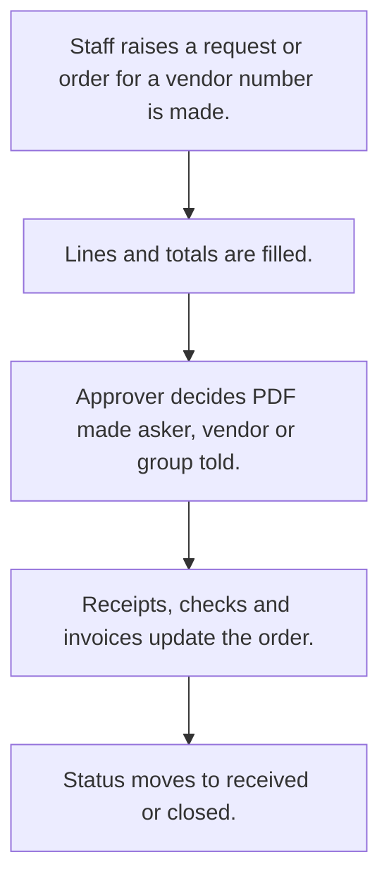

# Purchase orders

## Usual needs

- Usually has to raise a purchase order to a vendor with item lines, rate and tax.
- Usually has to sometimes start from a purchase request with item lines that a manager approves.
- Usually has to work out totals, tax and landing cost.
- Usually has to let an approver approve or reject and tell the asker or vendor.
- Usually has to sometimes check the order against a department monthly budget, alert when low and reset each month.
- Usually has to track status from receipts and checks (part received, in check, received).
- Usually has to sometimes record vendor invoices and payment against the order.
- Usually has to remind the team weekly about open orders.
- Usually has to print the order as a PDF.

## Process steps

1. Staff raises a request or order for a vendor; number is made.
2. Lines and totals are filled.
3. Approver decides; PDF made; asker, vendor or group told.
4. Receipts, checks and invoices update the order.
5. Status moves to received or closed.

## Usual sheets, key fields, roles

- PurchaseOrder: PurchaseOrderNo, Vendor, request ref, ExpectedDeliveryDate, lines (Material, Quantity, Rate, Total, received, approved, rejected), ApprovalStatus, Status, ReceivedAmount, PendingAmount
- PurchaseRequest (optional): Date, Department, lines, FinalAmount, Status, POGiven
- Department budget (optional): MonthlyBudget, MinimumBudgetLimit, RemainingMonthlyBudget (log number)
- Invoice (optional): order ref, Amount, PaymentStatus, TransactionType
- Roles: Store manager or purchase executive, Approver or operations manager, Admin.

## Neome App / Delivery hint

Neome App: purchase-management. Delivery: configuration. Hint only; grilling decides.

## Flowchart

