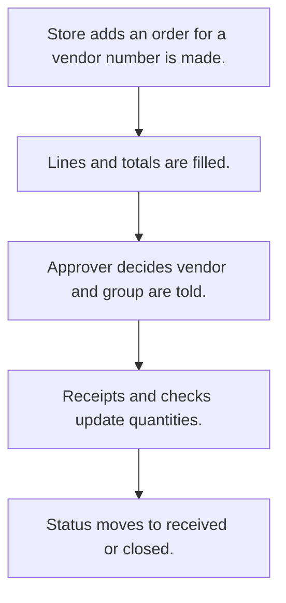

# Purchase orders

## Usual needs

- Usually has to raise a purchase order to a vendor with material lines, rate and tax.
- Usually has to work out totals, tax and landing cost.
- Usually has to let an approver approve or reject and tell the vendor.
- Usually has to track status from receipts and checks (part received, in check, received).
- Usually has to remind the team weekly about open orders.
- Usually has to print the order.

## Process steps

1. Store adds an order for a vendor; number is made.
2. Lines and totals are filled.
3. Approver decides; vendor and group are told.
4. Receipts and checks update quantities.
5. Status moves to received or closed.

## Usual sheets, key fields, roles

- PurchaseOrder: PurchaseOrderNo, Vendor, ExpectedDeliveryDate, lines (Material, Quantity, Rate, Total, received, approved, rejected), ApprovalStatus, Status
- Roles: Store manager, Approver.

## Neome App / Delivery hint

Neome App: purchase-management. Delivery: configuration. Hint only; grilling decides.

## Flowchart

