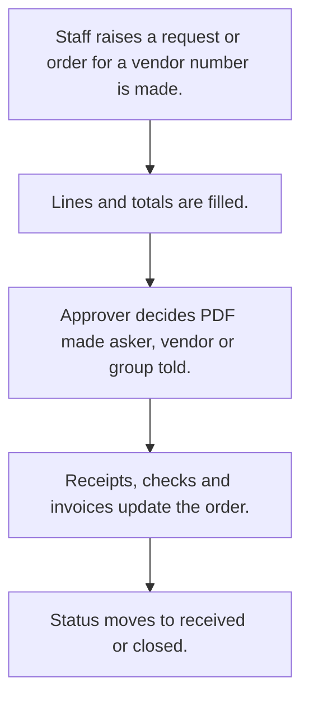

# Purchase orders

## Usual needs

- Usually has to raise a purchase order to a vendor with item lines, rate and tax.
- Usually has to sometimes start from a purchase request with item lines that a manager approves.
- Usually has to work out totals, tax and landing cost.
- Usually has to let an approver approve or reject and tell the asker or vendor.
- Usually has to sometimes check the order against a department monthly budget, alert when low and reset each month.
- Usually has to track status from receipts and checks (part received, in check, received).
- Usually has to sometimes record vendor invoices and payment against the order.
- Usually has to remind the team weekly about open orders.
- Usually has to print the order as a PDF.

## Process steps

1. Staff raises a request or order for a vendor; number is made.
2. Lines and totals are filled.
3. Approver decides; PDF made; asker, vendor or group told.
4. Receipts, checks and invoices update the order.
5. Status moves to received or closed.

## Usual sheets, key fields, roles

- PurchaseOrder: PurchaseOrderNo, Vendor, request ref, ExpectedDeliveryDate, lines (Material, Quantity, Rate, Total, received, approved, rejected), ApprovalStatus, Status, ReceivedAmount, PendingAmount
- PurchaseRequest (optional): Date, Department, lines, FinalAmount, Status, POGiven
- Department budget (optional): MonthlyBudget, MinimumBudgetLimit, RemainingMonthlyBudget (log number)
- Invoice (optional): order ref, Amount, PaymentStatus, TransactionType
- Roles: Store manager or purchase executive, Approver or operations manager, Admin.

## Neome App / Delivery hint

Neome App: purchase-management. Delivery: configuration. Hint only; grilling decides.

## Flowchart

## Execute

Only use this to apply this into a Studio Enterprise via MCP.

Placeholders: PurchaseOrder, PurchaseRequest, DepartmentBudget, Invoice, roles PurchaseExecutive, Approver, Admin. Needs first: Vendor and Material sheets (TMOD-master-data). Step 7 also needs inward + check sheets (TMOD-goods-inward, TMOD-quality-check); those need PurchaseOrderSheet, so run this Execute first, then theirs, then step 7. If Neome App purchase-management is installed, `list` and reuse it; build only gaps.

1. Roles + vars: `add kind=role` x3; `add kind=var kind=setOfText` ApprovalStatus {Pending|Approved|Rejected}, OrderStatus {Open|PartReceived|InCheck|Received|Closed}; `kind=sequence` PurchaseOrderNo.
2. PurchaseOrder form: section → `type=identifier` PurchaseOrderNo (`apply PAT-generated-id Execute`), `type=ref` Vendor (`apply PAT-copy-fields-from-ref Execute`), `type=ref` PurchaseRequest, `type=date` ExpectedDeliveryDate, `type=pickText` ApprovalStatus, Status, `type=decimal` ReceivedAmount, PendingAmount; grid Lines (`type=ref` Material, `type=decimal` Quantity, Rate, Total, Received, Approved, Rejected) → `PurchaseOrderSheet` → table + list layouts.
3. Totals, tax, landing cost: `apply PAT-line-items-grid-with-totals Execute`; checks: `apply PAT-error-field-check Execute`; lock after approve: `apply PAT-lock-fields-by-visibility Execute`.
4. Approval + tell: `apply PAT-approval-by-status Execute` + `apply PAT-message-on-event Execute` (asker, vendor, group). PDF: `apply PAT-pdf-from-report Execute`.
5. Optional PurchaseRequest form (Date, Department, lines grid, FinalAmount, Status, `type=bool` POGiven) → `PurchaseRequestSheet`; same approval pattern.
6. Optional budget: DepartmentBudget form (`type=decimal` MonthlyBudget, MinimumBudgetLimit, `type=logDecimal` RemainingMonthlyBudget) → sheet; `apply PAT-running-total-by-log-field Execute`; monthly reset: `apply PAT-scheduled-job-over-rows Execute`.
7. Only if TMOD-goods-inward / TMOD-quality-check are in the Enterprise, after their Execute. Status from receipts/checks: `apply PAT-status-from-quantities Execute` + `apply PAT-update-linked-rows Execute` (`eventSsUpdateAfter` on goods inward / quality check sheets).
8. Optional Invoice form (`type=ref` PurchaseOrder, `type=decimal` Amount, `type=pickText` PaymentStatus, TransactionType) → `InvoiceSheet`.
9. Weekly reminder: `apply PAT-scheduled-reminder-message Execute` (`eventSchedule` weekly → `ssSearchRows` open orders → `sendMessageToGroups`).
10. Reports: `apply PAT-query-report-with-filter Execute` + `apply PAT-composite-report Execute`.
11. Actions + group: `kind=rowInsert` / `kind=spreadsheetEditor` per sheet, `kind=report` → `set kind=group actionPermissionMap` (roles on every entry).
12. `validate` till ok=true.

Gaps: sequence var has no prefix/format prop (verify: describe); tax rule per Enterprise (Open Item).
