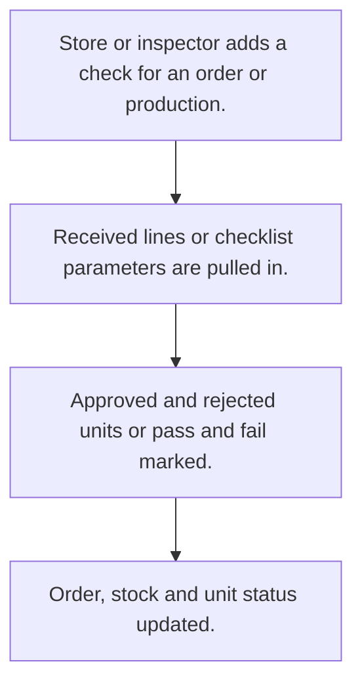

# Quality check

## Usual needs

- Usually has to check received material against a purchase order, and sometimes production output.
- Usually has to sometimes check against a checklist of parameters with tolerance, pass or fail each.
- Usually has to record approved and rejected quantity per material or unit.
- Usually has to attach lab, lab report and photo.
- Usually has to keep rejected share and reason.
- Usually has to block wrong entries.
- Usually has to update order and stock from the result.
- Usually has to sometimes show pass, fail and rejection counts by date range.

## Process steps

1. Store or inspector adds a check for an order or production.
2. Received lines or checklist parameters are pulled in.
3. Approved and rejected units or pass and fail marked.
4. Order, stock and unit status updated.

## Usual sheets, key fields, roles

- QualityCheck: Order ref, Lab ref, ReceivedDate, LabDocument, Image, lines (ApprovedQty, RejectedQty, RejectedPercentage, RejectedReason, Error)
- Checklist (optional): Name, parameter grid (ParameterName, ToleranceRange)
- Inspection (optional): InspectionType {GRN|Production}, checklist ref, Result per parameter, Pass and Failed counts
- Roles: Store manager or quality inspector, Admin.

## Neome App / Delivery hint

Neome App: quality-control. Delivery: configuration. Hint only; grilling decides.

## Flowchart

