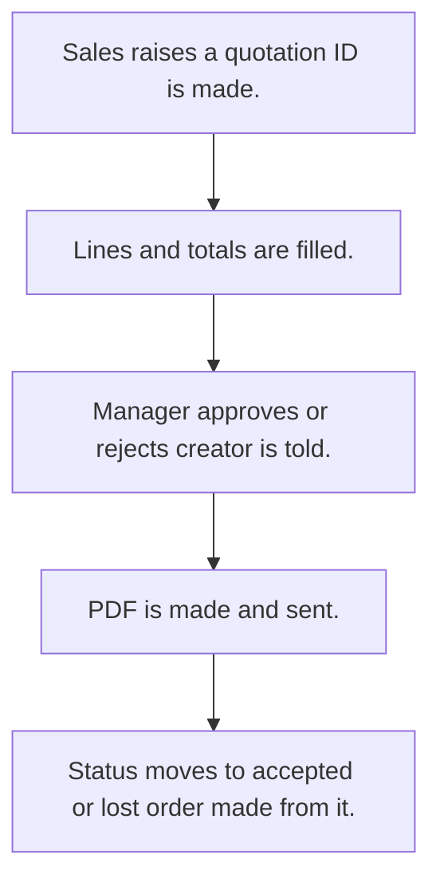

# Quotation

## Usual needs

- Usually has to raise a quotation for a customer, from a lead or without one.
- Usually has to list products with quantity, price, discount, tax and totals.
- Usually has to let a manager approve before it goes out.
- Usually has to make a PDF and send it to the customer by WhatsApp or email.
- Usually has to track status: sent, accepted, order taken, lost.
- Usually has to show whether an order was made from it.
- Usually has to tell the manager when totals change after entry.

## Process steps

1. Sales raises a quotation; ID is made.
2. Lines and totals are filled.
3. Manager approves or rejects; creator is told.
4. PDF is made and sent.
5. Status moves to accepted or lost; order made from it.

## Usual sheets, key fields, roles

- Quotation: QuotationId, Date, Customer, lead ref, products grid (Item, Price, Discount, Tax, Quantity, Total), totals, ApprovalStatus, Status, PDF, OrderCreated {Yes|No}
- Roles: Sales rep or coordinator, Sales manager, Accounts.

## Neome App / Delivery hint

Neome App: quotation-and-order-flow. Delivery: configuration. Hint only; grilling decides.

## Flowchart

