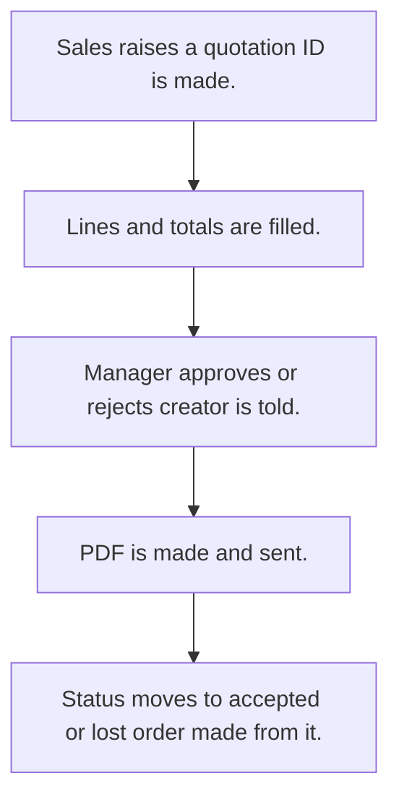

# Quotation

## Usual needs

- Usually has to raise a quotation for a customer, from a lead or without one.
- Usually has to list products with quantity, price, discount, tax and totals.
- Usually has to pick shipping method and payment terms from lists.
- Usually has to let a manager approve before it goes out.
- Usually has to make a PDF and send it to the customer by WhatsApp or email.
- Usually has to track status: sent, accepted, order taken, lost.
- Usually has to show whether an order was made from it.
- Usually has to tell the manager when totals change after entry.
- Usually has to show quotation counts and value for a date range.

## Process steps

1. Sales raises a quotation; ID is made.
2. Lines and totals are filled.
3. Manager approves or rejects; creator is told.
4. PDF is made and sent.
5. Status moves to accepted or lost; order made from it.

## Usual sheets, key fields, roles

- Quotation: QuotationId, Date, Customer, lead ref, ShippingMethod, PaymentTerms, products grid (Item, Price, Discount, Tax, Quantity, Total), totals, ApprovalStatus, Status, PDF, OrderCreated {Yes|No}
- Shipping method and payment terms lists
- Roles: Sales rep or coordinator, Sales manager, Accounts.

## Neome App / Delivery hint

Neome App: quotation-and-order-flow. Delivery: configuration. Hint only; grilling decides.

## Flowchart

## Execute

Only use this to apply this into a Studio Enterprise via MCP.

Placeholders: Quotation, ShippingMethod, PaymentTerms, roles SalesRep, SalesManager, Accounts. Needs first: Customer and Product sheets (TMOD-customer-master, TMOD-product-catalog); Lead sheet if from lead (TMOD-lead-management). If Neome App quotation-and-order-flow is installed, `list` and reuse it; build only gaps.

1. Roles + vars: `add kind=role` x3; `add kind=var kind=setOfText` ShippingMethod, PaymentTerms, ApprovalStatus {Pending|Approved|Rejected}, QuotationStatus {Sent|Accepted|OrderTaken|Lost}, YesNo; `kind=sequence` QuotationId.
2. Quotation form: section → `type=identifier` QuotationId (`apply PAT-generated-id Execute`), `type=date` Date, `type=ref` Customer (`apply PAT-copy-fields-from-ref Execute`), `type=ref` Lead (`apply PAT-pick-from-report-ref Execute` if filtered), `type=pickText` ShippingMethod, PaymentTerms, ApprovalStatus, Status, OrderCreated, `type=document` PDF; grid Products (`type=ref` Item, `type=decimal` Price, Discount, Tax, Quantity, Total) → `QuotationSheet` → table + list layouts.
3. Totals: `apply PAT-line-items-grid-with-totals Execute` + `apply PAT-calculated-field Execute`.
4. Approval: `apply PAT-approval-by-status Execute`; tell creator / manager on total change: `apply PAT-message-on-event Execute` (`eventSsUpdateAfter` + `branchIfElse`).
5. PDF + send: `apply PAT-pdf-from-report Execute` (`generatePdf outputField=PDF` → `sendWhatsappMessage` or `sendEmail attachmentField`).
6. Status moves: `apply PAT-act-on-status-change Execute`; order from it: `apply PAT-order-from-quote-or-direct Execute` (sets OrderCreated=Yes).
7. Reports: `apply PAT-query-report-with-filter Execute` + `apply PAT-composite-report Execute` (counts, value by date range).
8. Actions + group: `kind=rowInsert` / `kind=spreadsheetEditor` QuotationSheet, `kind=report` → `set kind=group actionPermissionMap` (roles on every entry).
9. `validate` till ok=true.

Gaps: WhatsApp send needs a template or channel set up outside MCP (Open Item).
