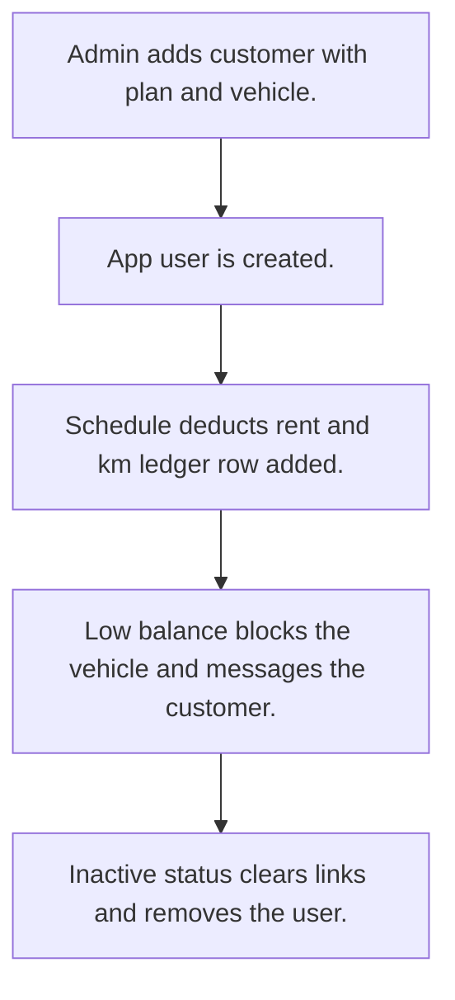

# Rental customers, plans and fleet

## Usual needs

- Usually has to keep rental customers, vehicles and small vehicle lists (branch, model, colour, type).
- Usually has to keep rental plans with price, duration, grace amount and km rules.
- Usually has to give each customer a plan, a vehicle, a rent balance and a km balance.
- Usually has to deduct rent and km on a schedule and log each deduction.
- Usually has to block the vehicle when balance is low and unblock after payment, through the device service.
- Usually has to tell the customer on low balance and on block or unblock.
- Usually has to add, update and remove the customer app user with the customer status.

## Process steps

1. Admin adds customer with plan and vehicle.
2. App user is created.
3. Schedule deducts rent and km; ledger row added.
4. Low balance blocks the vehicle and messages the customer.
5. Inactive status clears links and removes the user.

## Usual sheets, key fields, roles

- Customer: Branch, Status, Plan, Vehicle, RentalBalance (log), KmBalance (log)
- RentalPlan: PlanName, PlanDuration {Daily|Weekly}, RentalPrice, GraceAmount, km rules, Status
- Vehicle: Branch, Type, Model, VehicleStatus, MobilizationStatus, Customer
- Roles: Admin, Developer, Customer.

## Neome App / Delivery hint

Neome App: vehicle-and-driver-management (closest). Delivery: custom (device plugin, balance rules). Hint only; grilling decides.

## Flowchart

