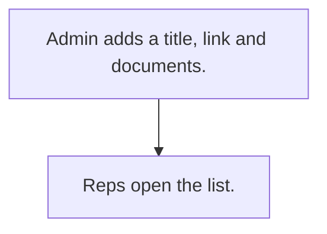

# Sales material library

## Usual needs

- Usually has to keep titled links and documents for the sales team.

## Process steps

1. Admin adds a title, link and documents.
2. Reps open the list.

## Usual sheets, key fields, roles

- Library item: Title, Link, Documents
- Roles: Admin, sales team.

## Neome App / Delivery hint

Neome App: knowledge-library. Delivery: standard. Hint only; grilling decides.

## Flowchart

