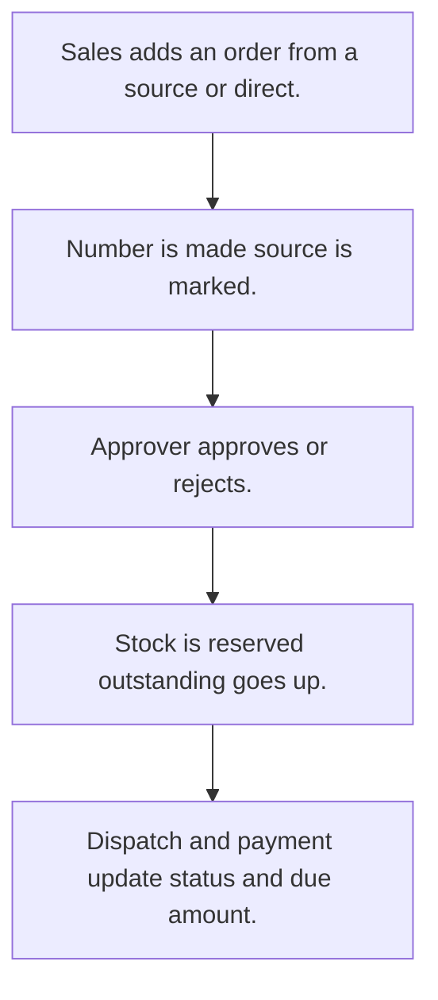

# Sales order

## Usual needs

- Usually has to raise an order for a customer from a quotation (or visit, enquiry, lead) or directly.
- Usually has to copy customer, transport and tax details from the customer.
- Usually has to work out line prices with customer discount, tax and totals.
- Usually has to let a manager approve or reject; tell the group or roles.
- Usually has to reserve stock and raise customer outstanding on approval.
- Usually has to track status through production, dispatch and delivery, and payment status.
- Usually has to send the order as a PDF by email or WhatsApp.
- Usually has to block remove once approved or dispatched; auto cancel and payment reminder by schedule.

## Process steps

1. Sales adds an order from a source or direct.
2. Number is made; source is marked.
3. Approver approves or rejects.
4. Stock is reserved; outstanding goes up.
5. Dispatch and payment update status and due amount.

## Usual sheets, key fields, roles

- Order: OrderId, Date, Source, source ref, Customer, products grid (Item, Rate, Discount, Quantity, DispatchedQty, Total), totals, ApprovalStatus {Pending|Approved|Rejected}, OrderStatus, PaymentStatus, DueAmount, PDF
- Roles: Sales rep or coordinator, Manager, Accounts, Admin.

## Neome App / Delivery hint

Neome App: quotation-and-order-flow. Delivery: configuration. Hint only; grilling decides.

## Flowchart

## Execute

Only use this to apply this into a Studio Enterprise via MCP.

Placeholders: Order, roles SalesRep, Manager, Accounts, Admin. Needs first: Customer, Product, stock sheets (TMOD-customer-master, TMOD-product-catalog, TMOD-inventory); QuotationSheet if from quote (TMOD-quotation). If Neome App quotation-and-order-flow is installed, `list` and reuse it; build only gaps.

1. Roles + vars: `add kind=role` x4; `add kind=var kind=setOfText` Source, ApprovalStatus {Pending|Approved|Rejected}, OrderStatus, PaymentStatus; `kind=sequence` OrderId.
2. Order form: section → `type=identifier` OrderId (`apply PAT-generated-id Execute`), `type=date` Date, `type=pickText` Source, source ref (`apply PAT-order-from-quote-or-direct Execute`, `apply PAT-pick-from-report-ref Execute`), `type=ref` Customer (`copyFieldMap` transport, tax), `type=pickText` ApprovalStatus, OrderStatus, PaymentStatus, `type=decimal` DueAmount, `type=document` PDF; grid Products (`type=ref` Item, `type=decimal` Rate, Discount, Quantity, DispatchedQty, Total) → `OrderSheet` → table + list layouts.
3. Prices + totals: `apply PAT-customer-price-list Execute` + `apply PAT-line-items-grid-with-totals Execute`.
4. Approval + tell: `apply PAT-approval-by-status Execute` + `apply PAT-message-on-event Execute`.
5. On approve: `apply PAT-stock-moves-by-workflow Execute` (reserve) + `apply PAT-insert-row-in-other-sheet Execute` (customer outstanding) + `apply PAT-update-linked-rows Execute` (mark source).
6. Status: `apply PAT-status-from-quantities Execute` (DispatchedQty vs Quantity). Block remove once approved/dispatched: `apply PAT-stop-save-by-workflow-check Execute` (`eventSsRemoveBefore` → `validate`/`stopAndError`).
7. Auto cancel + payment reminder: `apply PAT-per-row-scheduler Execute` (`executeScheduler` per row).
8. PDF + send: `apply PAT-pdf-from-report Execute` (`generatePdf` → `sendEmail` / `sendWhatsappMessage`).
9. Actions + group: `kind=rowInsert` / `kind=spreadsheetEditor` OrderSheet → `set kind=group actionPermissionMap` (roles on every entry).
10. `validate` till ok=true.

Gaps: whether `eventSsRemoveBefore` can stop a remove (verify: describe); outstanding sheet target per Enterprise (Open Item).
