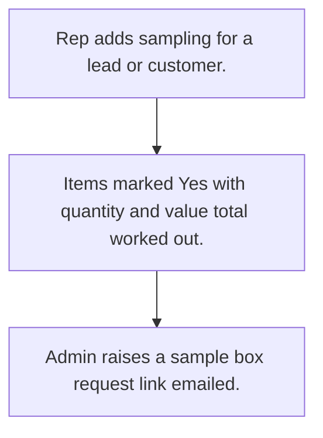

# Samples given

## Usual needs

- Usually has to record samples and display material given to a lead or customer, with quantity, value and photos.
- Usually has to work out total sample cost.
- Usually has to request a sample box for a customer and send the request link by email.

## Process steps

1. Rep adds sampling for a lead or customer.
2. Items marked Yes with quantity and value; total worked out.
3. Admin raises a sample box request; link emailed.

## Usual sheets, key fields, roles

- Sampling: Date, EnteredBy, type {Lead|Current Customer}, target, item Yes or No with quantity and value, TotalSamplingCost
- Sample box request: Date, Customer, samples grid, Status
- Roles: Sales rep, Manager, Admin.

## Neome App / Delivery hint

Neome App: none in the catalog. Delivery: configuration. Hint only; grilling decides.

## Flowchart

