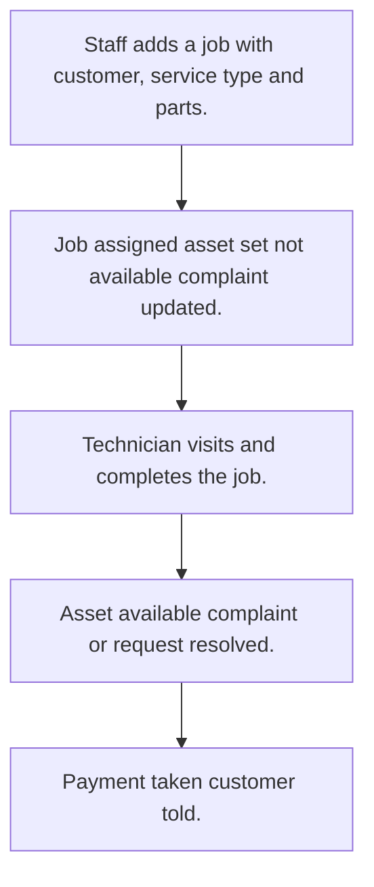

# Service job work

## Usual needs

- Usually has to open a service job or request for a customer or asset, from a complaint or direct, with type and priority.
- Usually has to assign the job to a technician and tell the manager.
- Usually has to sometimes work out an SLA escalation time and message while the job is open.
- Usually has to let the technician log the visit with place, photo, resolution note and customer signature.
- Usually has to list parts used with price, quantity and amount.
- Usually has to total parts, service cost and discount.
- Usually has to mark the asset not available while the job is open.
- Usually has to resolve the linked complaint or request when done.
- Usually has to take payment from deposit, balance, cash or online.
- Usually has to tell the customer when paid.
- Usually has to sometimes show request, visit and SLA breach counts.

## Process steps

1. Staff adds a job with customer, service type and parts.
2. Job assigned; asset set not available; complaint updated.
3. Technician visits and completes the job.
4. Asset available; complaint or request resolved.
5. Payment taken; customer told.

## Usual sheets, key fields, roles

- JobWork or ServiceRequest: Customer, Complaint ref, ServiceType, Priority, Territory, photos, Technician, Status {Open|In Progress|Waiting Parts|Completed|Cancelled}, EscalateDateTime, parts grid, totals, PaymentMode, PaymentStatus
- ServiceVisit: request ref, Location, ResolutionDateTime, ResolutionImage, CustomerSignature
- Part: PartName, MRP, Price
- ServiceType: ServiceType, SLAHours; territory and priority lists
- Roles: Technician, Service manager, Admin.

## Neome App / Delivery hint

Neome App: field-service (amc-and-service-management for contract visits). Delivery: configuration. Hint only; grilling decides.

## Flowchart

## Execute

Only use this to apply this into a Studio Enterprise via MCP.

Placeholders: JobWork, ServiceVisit, Part, ServiceType, Territory/Priority lists, roles Technician, ServiceManager, Admin. Needs first: Customer, asset, complaint sheets (TMOD-customer-master, TMOD-asset-assignment, TMOD-customer-complaints). If Neome App field-service is installed, `list` and reuse it; build only gaps.

1. Roles + vars: `add kind=role` x3; `add kind=var kind=setOfText` JobStatus {Open|InProgress|WaitingParts|Completed|Cancelled}, PaymentMode, PaymentStatus. Lists: `apply PAT-admin-kept-pick-list Execute` (PartSheet with MRP, Price; ServiceTypeSheet with SLAHours; Territory, Priority).
2. JobWork form: section → `type=ref` Customer, Complaint, ServiceType (`apply PAT-copy-fields-from-ref Execute`), `type=pickText` Priority, Territory, Status, PaymentMode, PaymentStatus, `type=pickUser` Technician (`roleIdDataSource=[Technician]`), `type=dateTime` EscalateDateTime, `type=image` Photos; grid Parts (`type=ref` Part, `type=decimal` Price, Quantity, Amount) + totals, Discount → `JobWorkSheet` → table + list layouts.
3. Totals + SLA time: `apply PAT-line-items-grid-with-totals Execute` + `apply PAT-calculated-field Execute`.
4. ServiceVisit form: `type=ref` JobWork, `type=location` Location, `type=dateTime` ResolutionDateTime, `type=camera` ResolutionImage, `type=signature` CustomerSignature → `ServiceVisitSheet`: `apply PAT-photo-and-document-capture Execute`.
5. Assign + status: `apply PAT-act-on-status-change Execute` + `apply PAT-message-on-event Execute` (tell manager); asset not available / complaint resolved: `apply PAT-update-linked-rows Execute`. Shared steps: `apply PAT-shared-sub-workflow Execute`.
6. SLA escalation: `apply PAT-per-row-scheduler Execute` + `apply PAT-scheduled-reminder-message Execute`.
7. Payment split (deposit, balance, cash, online): `apply PAT-split-payment-by-script Execute`; tell customer when paid: `apply PAT-message-on-event Execute`.
8. Counts: `apply PAT-query-report-with-filter Execute` + `apply PAT-composite-report Execute`.
9. Actions + group: `kind=rowInsert` / `kind=spreadsheetEditor` per sheet, `kind=report` → `set kind=group actionPermissionMap` (roles on every entry).
10. `validate` till ok=true.

Gaps: deposit/balance source sheet per Enterprise (Open Item).
