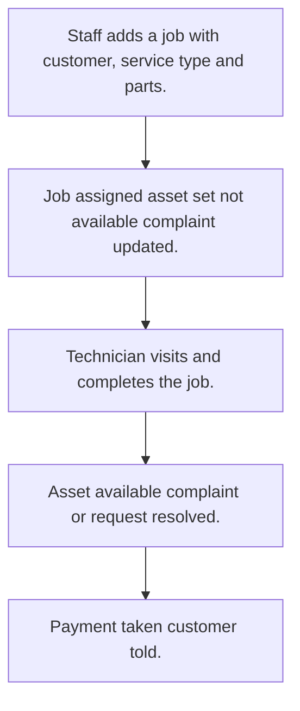

# Service job work

## Usual needs

- Usually has to open a service job or request for a customer or asset, from a complaint or direct, with type and priority.
- Usually has to assign the job to a technician and tell the manager.
- Usually has to sometimes work out an SLA escalation time and message while the job is open.
- Usually has to let the technician log the visit with place, photo, resolution note and customer signature.
- Usually has to list parts used with price, quantity and amount.
- Usually has to total parts, service cost and discount.
- Usually has to mark the asset not available while the job is open.
- Usually has to resolve the linked complaint or request when done.
- Usually has to take payment from deposit, balance, cash or online.
- Usually has to tell the customer when paid.
- Usually has to sometimes show request, visit and SLA breach counts.

## Process steps

1. Staff adds a job with customer, service type and parts.
2. Job assigned; asset set not available; complaint updated.
3. Technician visits and completes the job.
4. Asset available; complaint or request resolved.
5. Payment taken; customer told.

## Usual sheets, key fields, roles

- JobWork or ServiceRequest: Customer, Complaint ref, ServiceType, Priority, Territory, photos, Technician, Status {Open|In Progress|Waiting Parts|Completed|Cancelled}, EscalateDateTime, parts grid, totals, PaymentMode, PaymentStatus
- ServiceVisit: request ref, Location, ResolutionDateTime, ResolutionImage, CustomerSignature
- Part: PartName, MRP, Price
- ServiceType: ServiceType, SLAHours; territory and priority lists
- Roles: Technician, Service manager, Admin.

## Neome App / Delivery hint

Neome App: field-service (amc-and-service-management for contract visits). Delivery: configuration. Hint only; grilling decides.

## Flowchart

