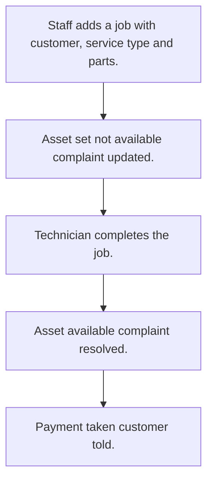

# Service job work

## Usual needs

- Usually has to open a service job for a customer asset, from a complaint or direct.
- Usually has to list parts used with price, quantity and amount.
- Usually has to total parts, service cost and discount.
- Usually has to mark the asset not available while the job is open.
- Usually has to resolve the linked complaint when done.
- Usually has to take payment from deposit, balance, cash or online.
- Usually has to tell the customer when paid.

## Process steps

1. Staff adds a job with customer, service type and parts.
2. Asset set not available; complaint updated.
3. Technician completes the job.
4. Asset available; complaint resolved.
5. Payment taken; customer told.

## Usual sheets, key fields, roles

- JobWork: Customer, Complaint ref, ServiceType, photos, Technician, Status {Open|In Progress|Waiting Parts|Completed|Cancelled}, parts grid, totals, PaymentMode, PaymentStatus
- Part: PartName, MRP, Price
- ServiceType: ServiceType
- Roles: Employee or technician, Admin.

## Neome App / Delivery hint

Neome App: amc-and-service-management. Delivery: configuration. Hint only; grilling decides.

## Flowchart

