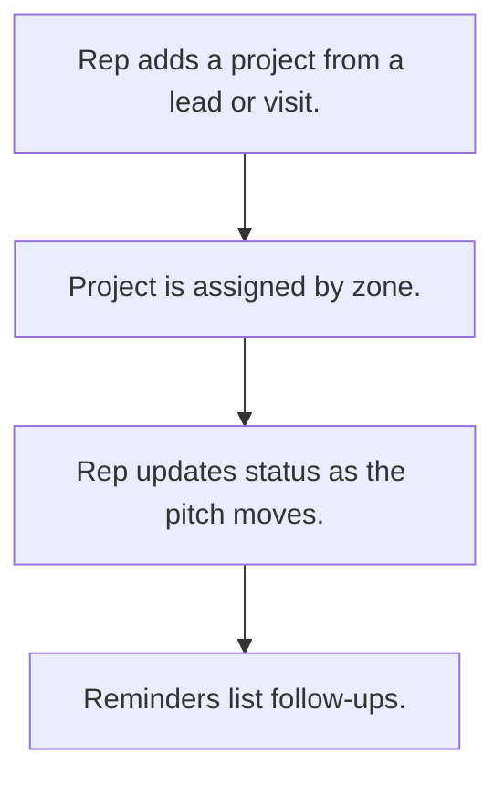

# Site project pipeline

## Usual needs

- Usually has to record a building or site project found through a lead or visit.
- Usually has to record the developer, architect and contractor contacts.
- Usually has to record project type, launch and completion dates and products to pitch.
- Usually has to assign the project to a zone executive and manager.
- Usually has to track status and remind for follow-up.

## Process steps

1. Rep adds a project from a lead or visit.
2. Project is assigned by zone.
3. Rep updates status as the pitch moves.
4. Reminders list follow-ups.

## Usual sheets, key fields, roles

- Project: Date, ImportFrom {Lead|Visit}, ProjectName, ProjectType, dates, products, AssignTo, Status, contact block
- Roles: Sales rep, Manager, Admin.

## Neome App / Delivery hint

Neome App: crm. Delivery: configuration. Hint only; grilling decides.

## Flowchart

## Execute

Only use this to apply this into a Studio Enterprise via MCP.

Placeholders: SiteProject, ZoneMapping, roles SalesRep, Manager, Admin. Needs first: Lead and visit sheets (TMOD-lead-management, TMOD-field-visits); ProductSheet for products to pitch (TMOD-product-catalog). If Neome App crm is installed, `list` and reuse it; build only gaps.

1. Roles + vars: `add kind=role` x3; `add kind=var kind=setOfText` ImportFrom {Lead|Visit}, ProjectType, ProjectStatus.
2. SiteProject form: section → `type=date` Date, `type=pickText` ImportFrom, source pick (`apply PAT-lead-or-customer-pick Execute`), `type=text` ProjectName, `type=pickText` ProjectType, Status, `type=date` LaunchDate, CompletionDate, `type=refSet` Products, `type=pickUser` AssignTo; contact section (developer, architect, contractor: `type=text` name, `type=mobileNumber`) → `SiteProjectSheet` → table layout.
3. Assign by zone: `apply PAT-assign-by-mapping-sheet Execute` (ZoneMappingSheet → AssignTo, Manager).
4. Follow-up list: `apply PAT-query-report-with-filter Execute` (open projects by follow-up date).
5. Actions + group: `kind=rowInsert` / `kind=spreadsheetEditor` SiteProjectSheet, `kind=report` → `set kind=group actionPermissionMap` (roles on every entry).
6. `validate` till ok=true.

Gaps: follow-up date field and reminder timing not in Usual sheets (Open Item).
