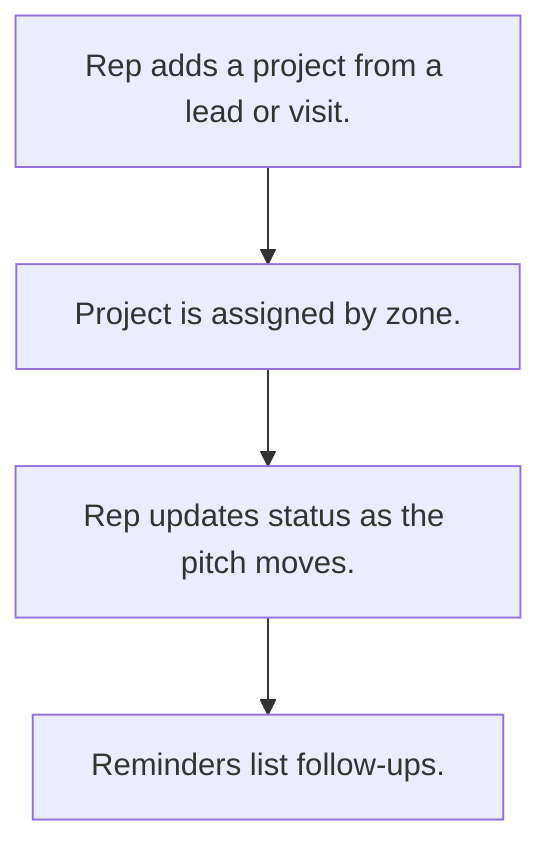

# Site project pipeline

## Usual needs

- Usually has to record a building or site project found through a lead or visit.
- Usually has to record the developer, architect and contractor contacts.
- Usually has to record project type, launch and completion dates and products to pitch.
- Usually has to assign the project to a zone executive and manager.
- Usually has to track status and remind for follow-up.

## Process steps

1. Rep adds a project from a lead or visit.
2. Project is assigned by zone.
3. Rep updates status as the pitch moves.
4. Reminders list follow-ups.

## Usual sheets, key fields, roles

- Project: Date, ImportFrom {Lead|Visit}, ProjectName, ProjectType, dates, products, AssignTo, Status, contact block
- Roles: Sales rep, Manager, Admin.

## Neome App / Delivery hint

Neome App: crm. Delivery: configuration. Hint only; grilling decides.

## Flowchart

