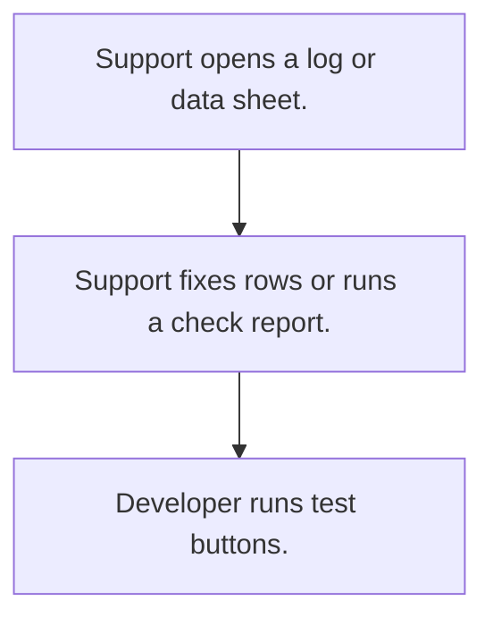

# Support and test tools

## Usual needs

- Usually has to let support fix live rows through role-limited sheets.
- Usually has to keep a debug log of workflow events.
- Usually has to let a developer try outside calls and see the result.
- Usually has to run gap check and compliance reports.

## Process steps

1. Support opens a log or data sheet.
2. Support fixes rows or runs a check report.
3. Developer runs test buttons.

## Usual sheets, key fields, roles

- Event log: Date, Employee, event, key fields
- Test sheet: inputs, buttons, results
- Roles: Support, Developer.

## Neome App / Delivery hint

Neome App: none. Delivery: custom (internal tools). Hint only; grilling decides.

## Flowchart

## Execute

Only use this to apply this into a Studio Enterprise via MCP.

Placeholders: EventLog, TestSheet, roles Support, Developer. Needs first: the live sheets support may fix.

1. Roles: `add kind=role` Support, Developer.
2. Event log + test sheet: `apply PAT-helper-sheet-for-tests-and-logs Execute` (EventLog form: `type=dateTime` Date, `type=pickUser` Employee, `type=text` Event, key fields → `EventLogSheet`; TestSheet form: inputs, `type=button` per test, result fields).
3. Fix live rows: `add kind=action kind=spreadsheetEditor spreadsheet=<LiveSheet> layoutSpreadsheet=<its table>` per sheet, only for Support.
4. Outside calls: `apply PAT-outside-service-by-plugin Execute` (test button → `executePlugin` or `executeRpc` → result field).
5. Gap and compliance checks: `apply PAT-query-report-with-filter Execute` → `kind=action kind=report`.
6. Group: `set kind=group actionPermissionMap` (Support, Developer only; roles on every entry).
7. `validate` till ok=true.

Gaps: which live sheets and checks are needed (Open Item); plugin is import only.
