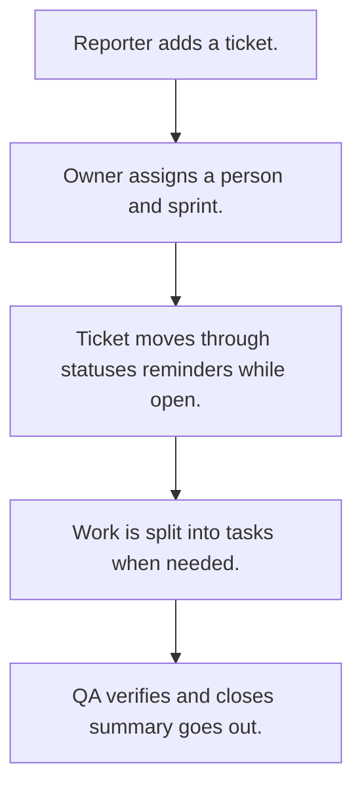

# Ticket tracker

## Usual needs

- Usually has to log bugs, features, tasks, change requests or customer issues as tickets with type or category, priority and module.
- Usually has to link a ticket to customers, a project, a parent or a duplicate.
- Usually has to assign an owner, a developer or support person, and a sprint when used.
- Usually has to move the ticket through a status list to resolved or closed and verified.
- Usually has to sometimes work out an SLA due time, message while open and escalate when late.
- Usually has to sometimes split a ticket into tasks.
- Usually has to show my tickets, assigned to me, and change history.
- Usually has to show a dashboard and sprint lanes.
- Usually has to tell people on new tickets and comments, and send a daily summary.

## Process steps

1. Reporter adds a ticket.
2. Owner assigns a person and sprint.
3. Ticket moves through statuses; reminders while open.
4. Work is split into tasks when needed.
5. QA verifies and closes; summary goes out.

## Usual sheets, key fields, roles

- Ticket: TicketId, Type or Category, Priority, Module, Customer, Status, Sprint ref, Parent ref, AssignedTo, OwnedBy, VerifyBy, SLADueDate, ResolutionHours
- Task (optional): Ticket ref, AssignedTo, DueDate, Status
- Sprint: Name, DateRange
- Category with SLA hours and priority lists
- Roles: Reporter or support executive, Developer, QA, Owner, Manager.

## Neome App / Delivery hint

Neome App: ticketing-and-task-management. Delivery: configuration. Hint only; grilling decides.

## Flowchart

## Execute

Only use this to apply this into a Studio Enterprise via MCP.

Placeholders: Ticket, Task, Sprint, Category, roles Reporter, Developer, QA, Owner, Manager. Needs first: Customer sheet if linked (TMOD-customer-master). If Neome App ticketing-and-task-management is installed, `list` and reuse it; build only gaps.

1. Roles + vars: `add kind=role` x5; `add kind=var kind=setOfText` TicketType, Priority, TicketStatus, TaskStatus; `kind=sequence` TicketId. Category list with SLAHours: `apply PAT-admin-kept-pick-list Execute`.
2. Sprint form: `type=text` Name, `type=dateRange` DateRange → `SprintSheet` + list layout.
3. Ticket form: section → `type=identifier` TicketId, `type=pickText` Type, Priority, Status, `type=ref` Category (`apply PAT-copy-fields-from-ref Execute`), `type=text` Module, `type=refSet` Customer (`apply PAT-pick-many-rows Execute`), `type=ref` Sprint, Parent (to TicketSheet), `type=pickUser` AssignedTo, OwnedBy, VerifyBy, `type=dateTime` SLADueDate, `type=decimal` ResolutionHours → `TicketSheet` → table + list + kanban (`kanbanField=Status`) layouts.
4. SLA due + hours: `apply PAT-calculated-field Execute`.
5. Views: `apply PAT-role-views-of-one-sheet Execute` (my tickets, assigned to me: `spreadsheetEditor` with `filterCondition`); history: `apply PAT-sheet-history-action Execute`.
6. Task form (optional): `type=ref` Ticket, `type=pickUser` AssignedTo, `type=date` DueDate, `type=pickText` Status → `TaskSheet`; split from ticket: `apply PAT-trigger-row-for-workflow Execute` + `apply PAT-update-linked-rows Execute`.
7. Messages: `apply PAT-message-on-event Execute` (`eventSsInsertAfter`, `eventRowComment`); status moves: `apply PAT-act-on-status-change Execute`; SLA nudges: `apply PAT-per-row-scheduler Execute`; daily summary: `apply PAT-scheduled-reminder-message Execute`. Shared steps: `apply PAT-shared-sub-workflow Execute`.
8. Dashboard + sprint lanes: `apply PAT-query-report-with-filter Execute`, `apply PAT-composite-report Execute`, `apply PAT-board-from-lane-reports Execute`.
9. Actions + group: `kind=rowInsert` / `kind=spreadsheetEditor` / `kind=spreadsheetHistory` / `kind=report` → `set kind=group actionPermissionMap` (roles on every entry).
10. `validate` till ok=true.

Gaps: self ref (Parent on TicketSheet) needs sheet made before the ref field (verify: describe).
