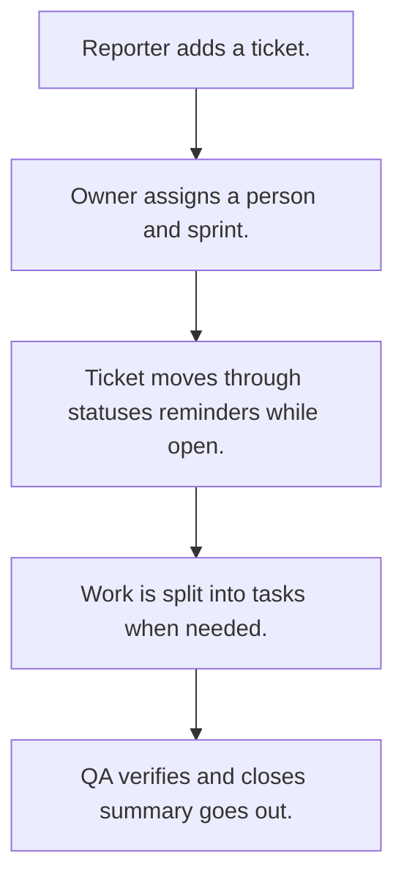

# Ticket tracker

## Usual needs

- Usually has to log bugs, features, tasks, change requests or customer issues as tickets with type or category, priority and module.
- Usually has to link a ticket to customers, a project, a parent or a duplicate.
- Usually has to assign an owner, a developer or support person, and a sprint when used.
- Usually has to move the ticket through a status list to resolved or closed and verified.
- Usually has to sometimes work out an SLA due time, message while open and escalate when late.
- Usually has to sometimes split a ticket into tasks.
- Usually has to show my tickets, assigned to me, and change history.
- Usually has to show a dashboard and sprint lanes.
- Usually has to tell people on new tickets and comments, and send a daily summary.

## Process steps

1. Reporter adds a ticket.
2. Owner assigns a person and sprint.
3. Ticket moves through statuses; reminders while open.
4. Work is split into tasks when needed.
5. QA verifies and closes; summary goes out.

## Usual sheets, key fields, roles

- Ticket: TicketId, Type or Category, Priority, Module, Customer, Status, Sprint ref, Parent ref, AssignedTo, OwnedBy, VerifyBy, SLADueDate, ResolutionHours
- Task (optional): Ticket ref, AssignedTo, DueDate, Status
- Sprint: Name, DateRange
- Category with SLA hours and priority lists
- Roles: Reporter or support executive, Developer, QA, Owner, Manager.

## Neome App / Delivery hint

Neome App: ticketing-and-task-management. Delivery: configuration. Hint only; grilling decides.

## Flowchart

