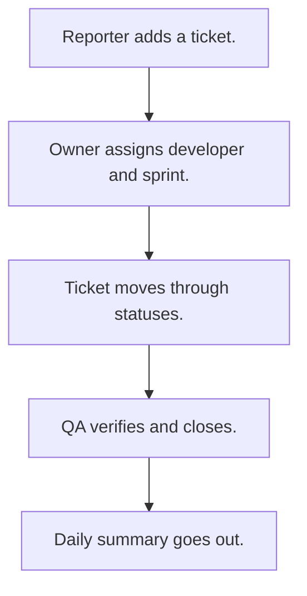

# Ticket tracker

## Usual needs

- Usually has to log bugs, features, tasks or change requests as tickets with type, priority and module.
- Usually has to link a ticket to customers, a project, a parent or a duplicate.
- Usually has to assign an owner, a developer and a sprint.
- Usually has to move the ticket through a status list to closed and verified.
- Usually has to show my tickets, assigned to me, and change history.
- Usually has to show a dashboard and sprint lanes.
- Usually has to tell people on new tickets and comments, and send a daily summary.

## Process steps

1. Reporter adds a ticket.
2. Owner assigns developer and sprint.
3. Ticket moves through statuses.
4. QA verifies and closes.
5. Daily summary goes out.

## Usual sheets, key fields, roles

- Ticket: TicketId, Type, Priority, Module, Status, Sprint ref, Parent ref, customer refs, AssignedTo, OwnedBy, VerifyBy
- Sprint: Name, DateRange
- Roles: Reporter, Developer, QA, Owner, Manager.

## Neome App / Delivery hint

Neome App: ticketing-and-task-management. Delivery: configuration. Hint only; grilling decides.

## Flowchart

