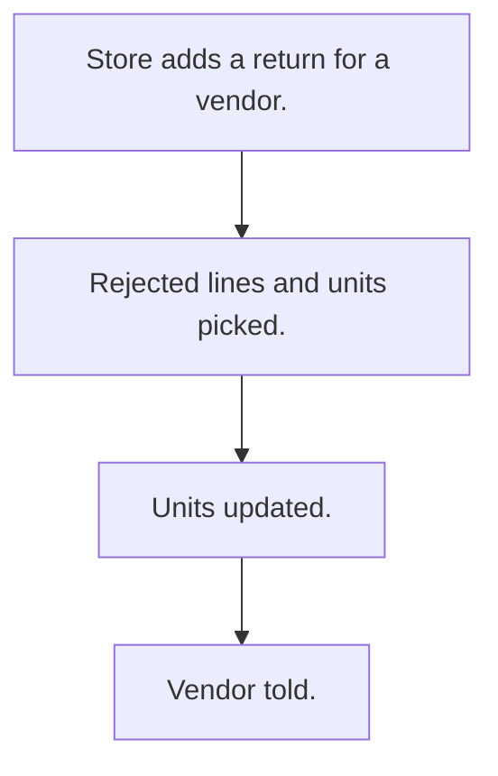

# Return to vendor

## Usual needs

- Usually has to return rejected material to the vendor.
- Usually has to show rejected and still-to-return quantity per material.
- Usually has to pick and update the returned units.
- Usually has to note transport, vehicle and labour cost with a document.
- Usually has to tell the vendor.

## Process steps

1. Store adds a return for a vendor.
2. Rejected lines and units picked.
3. Units updated.
4. Vendor told.

## Usual sheets, key fields, roles

- Return: ReturnDate, Vendor, Transport, VehicleNo, cost, Document, lines (rejected ref, units, ReturnQty)
- Roles: Store manager.

## Neome App / Delivery hint

Neome App: purchase-management. Delivery: configuration. Hint only; grilling decides.

## Flowchart

