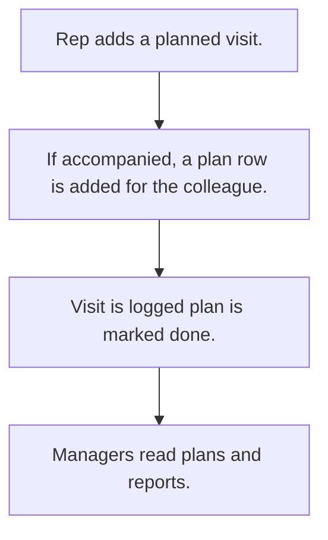

# Visit planning

## Usual needs

- Usually has to let a rep plan a visit to a lead or customer on a date.
- Usually has to copy the plan to a colleague who comes along.
- Usually has to let managers see team plans and today's plans.
- Usually has to mark the plan done when the visit is logged.
- Usually has to report planned versus done visits.

## Process steps

1. Rep adds a planned visit.
2. If accompanied, a plan row is added for the colleague.
3. Visit is logged; plan is marked done.
4. Managers read plans and reports.

## Usual sheets, key fields, roles

- VisitPlanning: PlanningId, PlannedVisitDate, EnteredBy, Manager, target (lead or customer), AccompaniedBy, VisitStatus {Pending|Completed}
- Roles: Sales rep, Manager, Viewer.

## Neome App / Delivery hint

Neome App: field-visit-management. Delivery: configuration. Hint only; grilling decides.

## Flowchart

## Execute

Only use this to apply this into a Studio Enterprise via MCP.

Placeholders: VisitPlanning, roles SalesRep, Manager, Viewer. Needs first: Lead, Customer, visit sheets (TMOD-lead-management, TMOD-customer-master, TMOD-field-visits). If Neome App field-visit-management is installed, `list` and reuse it; build only gaps.

1. Roles + vars: `add kind=role` x3; `add kind=var kind=setOfText` VisitStatus {Pending|Completed}; `kind=sequence` PlanningId.
2. VisitPlanning form: section → `type=identifier` PlanningId, `type=date` PlannedVisitDate, `type=userId defaultValue=createdBy` EnteredBy, `type=pickUser` Manager, target (`apply PAT-lead-or-customer-pick Execute`), `type=pickUser` AccompaniedBy, `type=pickText` VisitStatus → `VisitPlanningSheet` → table + calendar (`fromDateField=PlannedVisitDate`) layouts.
3. Colleague copy: `apply PAT-insert-row-in-other-sheet Execute` (`eventSsInsertAfter` → `branchIfElse` AccompaniedBy hasValue → `rowInsert spreadsheet=VisitPlanningSheet`).
4. Mark done on visit: workflow `eventSsInsertAfter spreadsheet=<VisitSheet>` → `rowUpdate` VisitStatus=Completed (verify: describe).
5. Views: `apply PAT-role-views-of-one-sheet Execute` (my, team, today: `spreadsheetEditor` + `filterCondition`).
6. Planned vs done: `report kind=query` or `kind=spreadsheet` → `kind=action kind=report`.
7. Group: `set kind=group actionPermissionMap` (roles on every entry).
8. `validate` till ok=true.

Gaps: link from visit row to plan row (key field) per Enterprise (Open Item).
