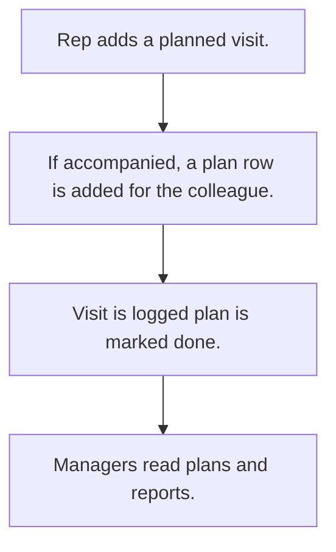

# Visit planning

## Usual needs

- Usually has to let a rep plan a visit to a lead or customer on a date.
- Usually has to copy the plan to a colleague who comes along.
- Usually has to let managers see team plans and today's plans.
- Usually has to mark the plan done when the visit is logged.
- Usually has to report planned versus done visits.

## Process steps

1. Rep adds a planned visit.
2. If accompanied, a plan row is added for the colleague.
3. Visit is logged; plan is marked done.
4. Managers read plans and reports.

## Usual sheets, key fields, roles

- VisitPlanning: PlanningId, PlannedVisitDate, EnteredBy, Manager, target (lead or customer), AccompaniedBy, VisitStatus {Pending|Completed}
- Roles: Sales rep, Manager, Viewer.

## Neome App / Delivery hint

Neome App: field-visit-management. Delivery: configuration. Hint only; grilling decides.

## Flowchart

