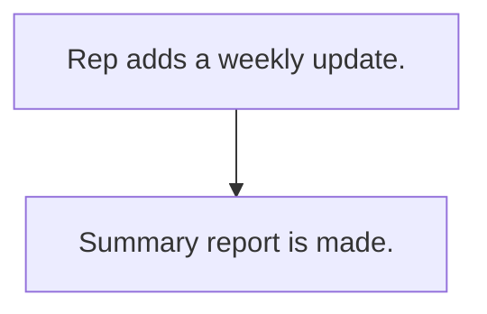

# Weekly update note

## Usual needs

- Usually has to let a rep write a weekly note about a lead or customer.
- Usually has to make a weekly summary report to share.

## Process steps

1. Rep adds a weekly update.
2. Summary report is made.

## Usual sheets, key fields, roles

- Weekly update: Date, PreparedBy, target, Remarks
- Roles: Sales rep, Manager, Admin.

## Neome App / Delivery hint

Neome App: none. Delivery: configuration. Hint only; grilling decides.

## Flowchart

## Execute

Only use this to apply this into a Studio Enterprise via MCP.

Placeholders: WeeklyUpdate, roles SalesRep, Manager, Admin. Needs first: Lead and Customer sheets (TMOD-lead-management, TMOD-customer-master).

1. Roles: `add kind=role` x3.
2. WeeklyUpdate form: section → `type=date` Date, `type=userId defaultValue=createdBy` PreparedBy, target (`apply PAT-lead-or-customer-pick Execute`), `type=paragraph` Remarks → `WeeklyUpdateSheet` → table layout.
3. Summary: `apply PAT-query-report-with-filter Execute` (week date range) → `kind=action kind=report`; delayed send if needed: `apply PAT-delayed-call-by-formula Execute`.
4. Actions + group: `kind=rowInsert` / `kind=spreadsheetEditor` WeeklyUpdateSheet → `set kind=group actionPermissionMap` (roles on every entry).
5. `validate` till ok=true.

Gaps: none.
