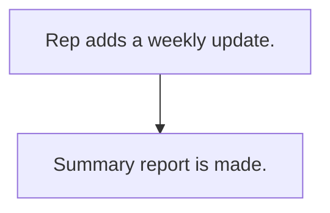

# Weekly update note

## Usual needs

- Usually has to let a rep write a weekly note about a lead or customer.
- Usually has to make a weekly summary report to share.

## Process steps

1. Rep adds a weekly update.
2. Summary report is made.

## Usual sheets, key fields, roles

- Weekly update: Date, PreparedBy, target, Remarks
- Roles: Sales rep, Manager, Admin.

## Neome App / Delivery hint

Neome App: none. Delivery: configuration. Hint only; grilling decides.

## Flowchart

