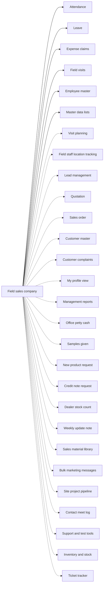

# Field sales company

## Modules

Core:

- TMOD-attendance (Attendance)
- TMOD-leave (Leave)
- TMOD-expense-claims (Expense claims)
- TMOD-field-visits (Field visits)
- TMOD-employee-master (Employee master)
- TMOD-master-data (Master data lists)

Optional:

- TMOD-visit-planning (Visit planning)
- TMOD-location-tracking (Field staff location tracking)
- TMOD-lead-management (Lead management)
- TMOD-quotation (Quotation)
- TMOD-sales-order (Sales order)
- TMOD-customer-master (Customer master)
- TMOD-customer-complaints (Customer complaints)
- TMOD-my-profile (My profile view)
- TMOD-management-reports (Management reports)
- TMOD-office-petty-cash (Office petty cash)
- TMOD-samples (Samples given)
- TMOD-new-product-request (New product request)
- TMOD-credit-note-request (Credit note request)
- TMOD-dealer-stock-count (Dealer stock count)
- TMOD-weekly-update (Weekly update note)
- TMOD-knowledge-library (Knowledge library)
- TMOD-bulk-marketing-messages (Bulk marketing messages)
- TMOD-site-project-pipeline (Site project pipeline)
- TMOD-contact-meet-log (Contact meet log)
- TMOD-support-tools (Support and test tools)
- TMOD-inventory (Inventory and stock)
- TMOD-ticket-tracker (Ticket tracker)

## Links between modules

- Clients, leads and expenses pick from master data lists (place, category, expense category).
- Visits ref planned visits; follow-ups add new plans.
- Quotation refs customer; order refs quotation and visit.
- Clock and visit events feed the location trail.
- Petty cash is given to an employee.

## Flowchart

