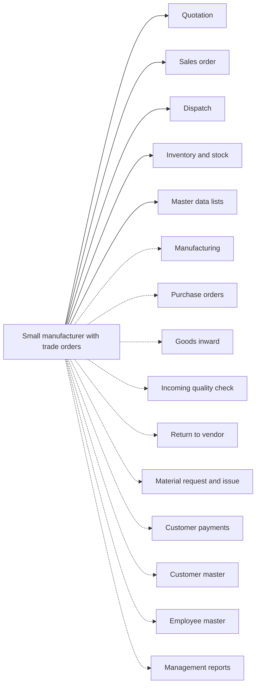

# Small manufacturer with trade orders

## Modules

Core:

- TMOD-quotation (Quotation)
- TMOD-sales-order (Sales order)
- TMOD-dispatch (Dispatch)
- TMOD-inventory (Inventory and stock)
- TMOD-master-data (Master data lists)

Optional:

- TMOD-manufacturing (Manufacturing)
- TMOD-purchase-orders (Purchase orders)
- TMOD-goods-inward (Goods inward)
- TMOD-quality-check (Quality check)
- TMOD-vendor-return (Return to vendor)
- TMOD-material-request (Material request and issue)
- TMOD-customer-payments (Customer payments)
- TMOD-customer-master (Customer master)
- TMOD-employee-master (Employee master)
- TMOD-management-reports (Management reports)

## Links between modules

- Sales chain: quotation → sales order → dispatch → customer payment.
- Purchase chain: purchase order → goods inward → quality check → inventory.
- Manufacturing uses products, units and warehouses; production adds stock and uses material.
- Dispatch takes stock from a warehouse; material requests and returns change stock.
- Master data feeds every module.

## Flowchart

## Execute

Only use this to apply this into a Studio Enterprise via MCP.

Placeholders: shared roles Admin, Manager; one Execute per Template module. Needs first: confirm the module list with the user; `list` first and reuse Neome Apps already installed (quotation-and-order-flow, inventory-and-stock-management, manufacturing).

1. Roles: `add kind=role` Admin, Manager (modules add their own).
2. `apply TMOD-master-data Execute` — units, warehouses, vendors, categories.
3. Stock: `apply TMOD-inventory Execute` (needs the master lists).
4. Sales chain in order: `apply TMOD-customer-master Execute` (optional) → `apply TMOD-quotation Execute` → `apply TMOD-sales-order Execute` → `apply TMOD-dispatch Execute` → `apply TMOD-customer-payments Execute` (optional).
5. Purchase chain: `apply TMOD-purchase-orders Execute` → `apply TMOD-goods-inward Execute` → `apply TMOD-quality-check Execute` → `apply TMOD-vendor-return Execute` (optional).
6. Production: `apply TMOD-manufacturing Execute` → `apply TMOD-material-request Execute` (optional).
7. Each other chosen optional module: `apply TMOD-<id> Execute`; reports last (`apply TMOD-management-reports Execute` → `add kind=action kind=report` → `set kind=group actionPermissionMap`).
8. Links between modules, after both sides exist: quotation → order → dispatch → payment refs; purchase → inward → check → stock refs; dispatch and material issue move stock by workflow; production adds stock.
9. `validate` till ok=true after each module and at the end. `describe` key sheets and workflows.

Gaps: none here; each module Execute carries its own.
