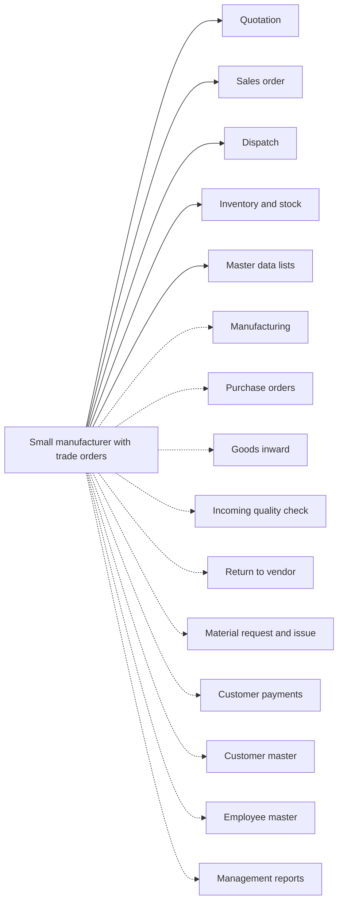

# Small manufacturer with trade orders

## Modules

Core:

- TMOD-quotation (Quotation)
- TMOD-sales-order (Sales order)
- TMOD-dispatch (Dispatch)
- TMOD-inventory (Inventory and stock)
- TMOD-master-data (Master data lists)

Optional:

- TMOD-manufacturing (Manufacturing)
- TMOD-purchase-orders (Purchase orders)
- TMOD-goods-inward (Goods inward)
- TMOD-incoming-quality-check (Incoming quality check)
- TMOD-vendor-return (Return to vendor)
- TMOD-material-request (Material request and issue)
- TMOD-customer-payments (Customer payments)
- TMOD-customer-master (Customer master)
- TMOD-employee-master (Employee master)
- TMOD-management-reports (Management reports)

## Links between modules

- Sales chain: quotation → sales order → dispatch → customer payment.
- Purchase chain: purchase order → goods inward → quality check → inventory.
- Manufacturing uses products, units and warehouses; production adds stock and uses material.
- Dispatch takes stock from a warehouse; material requests and returns change stock.
- Master data feeds every module.

## Flowchart

