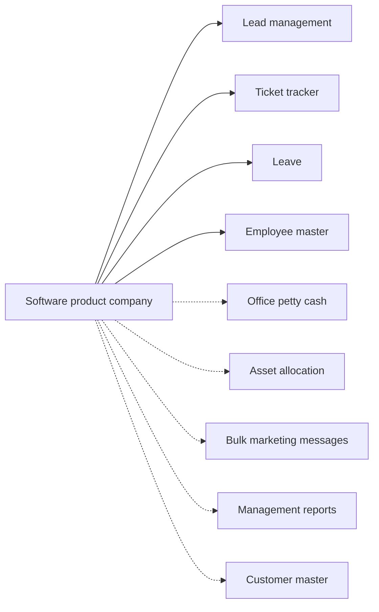

# Software product company

## Modules

Core:

- TMOD-lead-management (Lead management)
- TMOD-ticket-tracker (Ticket tracker)
- TMOD-leave (Leave)
- TMOD-employee-master (Employee master)

Optional:

- TMOD-office-petty-cash (Office petty cash)
- TMOD-asset-allocation (Asset allocation)
- TMOD-bulk-marketing-messages (Bulk marketing messages)
- TMOD-management-reports (Management reports)
- TMOD-customer-master (Customer master)

## Links between modules

- Projects come from won leads; tickets ref the project.
- Tickets ref the customer list.
- Leave reads the employee master.

## Flowchart

## Execute

Only use this to apply this into a Studio Enterprise via MCP.

Placeholders: shared roles Admin, Manager; one Execute per Template module. Needs first: confirm the module list with the user; `list` first and reuse Neome Apps already installed (lead-management, ticketing-and-task-management).

1. Roles: `add kind=role` Admin, Manager (modules add their own).
2. `apply TMOD-employee-master Execute` — employees and managers.
3. `apply TMOD-lead-management Execute` (needs customer and product sheets; `apply TMOD-customer-master Execute` first if wanted).
4. `apply TMOD-ticket-tracker Execute` — tickets ref the project inside the module.
5. `apply TMOD-leave Execute` — reads the employee master.
6. Each chosen optional module: `apply TMOD-<id> Execute` — TMOD-office-petty-cash, TMOD-asset-allocation, TMOD-bulk-marketing-messages; reports last (`apply TMOD-management-reports Execute` → `add kind=action kind=report` → `set kind=group actionPermissionMap`).
7. Links between modules, after both sides exist: won leads open projects and tickets ref the project; tickets ref the customer list; leave reads the employee master.
8. `validate` till ok=true after each module and at the end. `describe` key sheets and workflows.

Gaps: none here; each module Execute carries its own.
