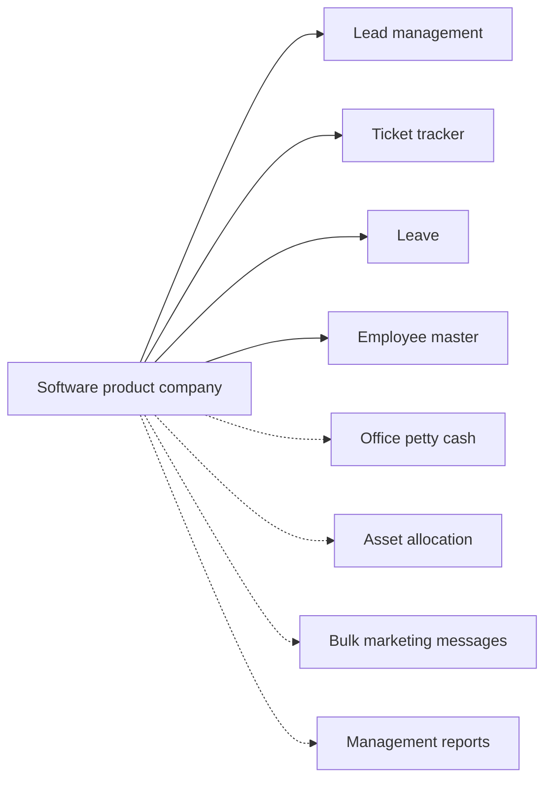

# Software product company

## Modules

Core:

- TMOD-lead-management (Lead management)
- TMOD-ticket-tracker (Ticket tracker)
- TMOD-leave (Leave)
- TMOD-employee-master (Employee master)

Optional:

- TMOD-office-petty-cash (Office petty cash)
- TMOD-asset-allocation (Asset allocation)
- TMOD-bulk-marketing-messages (Bulk marketing messages)
- TMOD-management-reports (Management reports)

## Links between modules

- Projects come from won leads; tickets ref the project.
- Tickets ref the customer list.
- Leave reads the employee master.

## Flowchart

