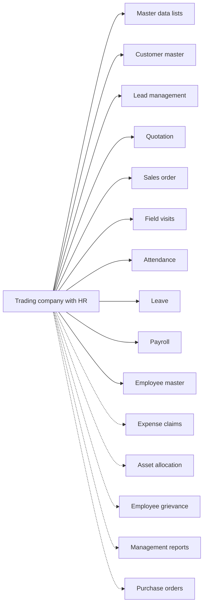

# Trading company with HR

## Modules

Core:

- TMOD-master-data (Master data lists)
- TMOD-customer-master (Customer master)
- TMOD-lead-management (Lead management)
- TMOD-quotation (Quotation)
- TMOD-sales-order (Sales order)
- TMOD-field-visits (Field visits)
- TMOD-attendance (Attendance)
- TMOD-leave (Leave)
- TMOD-payroll (Payroll)
- TMOD-employee-master (Employee master)

Optional:

- TMOD-expense-claims (Expense claims)
- TMOD-asset-allocation (Asset allocation)
- TMOD-employee-grievance (Employee grievance)
- TMOD-management-reports (Management reports)
- TMOD-purchase-orders (Purchase orders)

## Links between modules

- Lead, quotation and visit ref customer and product from master data.
- Quotation refs lead; order refs quotation.
- Leave refs leave type; attendance refs department and designation.
- Asset allocation refs the employee.
- Payroll reads attendance and leave.

## Flowchart

## Execute

Only use this to apply this into a Studio Enterprise via MCP.

Placeholders: shared roles Admin, Employee, Manager, HR; one Execute per Template module. Needs first: confirm the module list with the user; `list` first and reuse Neome Apps already installed (crm, quotation-and-order-flow, attendance-and-leave).

1. Roles: `add kind=role` Admin, Employee, Manager, HR (modules add their own).
2. `apply TMOD-master-data Execute` → `apply TMOD-employee-master Execute` (department, designation, pay fields).
3. Sales: `apply TMOD-customer-master Execute` → `apply TMOD-lead-management Execute` → `apply TMOD-quotation Execute` → `apply TMOD-sales-order Execute` → `apply TMOD-field-visits Execute`.
4. HR: `apply TMOD-attendance Execute` → `apply TMOD-leave Execute` → `apply TMOD-payroll Execute` (payroll reads attendance, leave and pay fields).
5. Each chosen optional module: `apply TMOD-<id> Execute` — TMOD-expense-claims, TMOD-asset-allocation, TMOD-employee-grievance, TMOD-purchase-orders.
6. Links between modules, after both sides exist: lead, quotation and visit ref customer and product from master data; quotation refs lead, order refs quotation; leave refs leave type, attendance refs department and designation; asset allocation refs the employee; payroll reads attendance and leave.
7. Reports last: `apply TMOD-management-reports Execute` → `add kind=action kind=report` → `set kind=group actionPermissionMap`.
8. `validate` till ok=true after each module and at the end. `describe` key sheets and workflows.

Gaps: none here; each module Execute carries its own.
