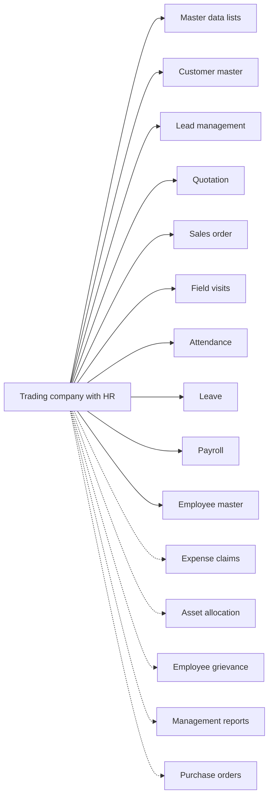

# Trading company with HR

## Modules

Core:

- TMOD-master-data (Master data lists)
- TMOD-customer-master (Customer master)
- TMOD-lead-management (Lead management)
- TMOD-quotation (Quotation)
- TMOD-sales-order (Sales order)
- TMOD-field-visits (Field visits)
- TMOD-attendance (Attendance)
- TMOD-leave (Leave)
- TMOD-payroll (Payroll)
- TMOD-employee-master (Employee master)

Optional:

- TMOD-expense-claims (Expense claims)
- TMOD-asset-allocation (Asset allocation)
- TMOD-employee-grievance (Employee grievance)
- TMOD-management-reports (Management reports)
- TMOD-purchase-orders (Purchase orders)

## Links between modules

- Lead, quotation and visit ref customer and product from master data.
- Quotation refs lead; order refs quotation.
- Leave refs leave type; attendance refs department and designation.
- Asset allocation refs the employee.
- Payroll reads attendance and leave.

## Flowchart

