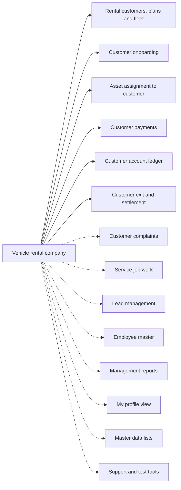

# Vehicle rental company

## Modules

Core:

- TMOD-rental-customer-and-fleet (Rental customers, plans and fleet)
- TMOD-customer-onboarding (Customer onboarding)
- TMOD-asset-assignment (Asset assignment to customer)
- TMOD-customer-payments (Customer payments)
- TMOD-customer-account-ledger (Customer account ledger)
- TMOD-customer-exit-settlement (Customer exit and settlement)

Optional:

- TMOD-customer-complaints (Customer complaints)
- TMOD-service-job-work (Service job work)
- TMOD-lead-management (Lead management)
- TMOD-employee-master (Employee master)
- TMOD-management-reports (Management reports)
- TMOD-my-profile (My profile view)
- TMOD-master-data (Master data lists)
- TMOD-support-tools (Support and test tools)

## Links between modules

- Onboarding makes the customer row (customer onboarding → rental customers).
- Asset assignment refs customer and vehicle.
- Payments, ledger and exit ref the customer.
- Complaints ref the customer; service jobs ref the complaint.

## Flowchart

