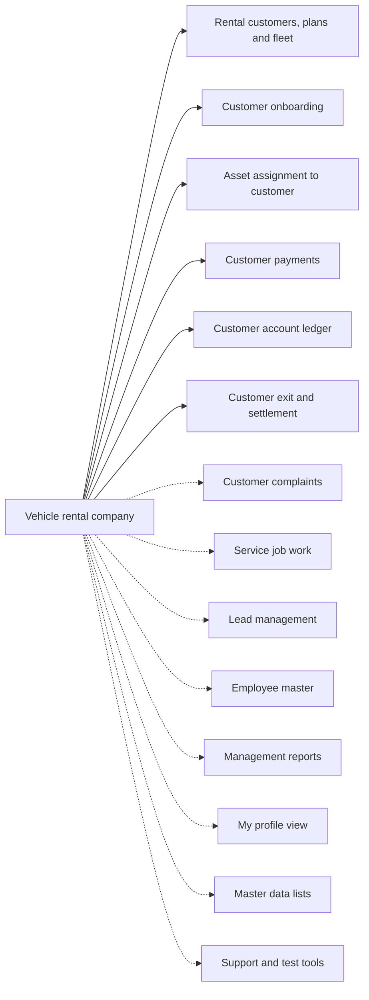

# Vehicle rental company

## Modules

Core:

- TMOD-rental-customer-and-fleet (Rental customers, plans and fleet)
- TMOD-customer-onboarding (Customer onboarding)
- TMOD-asset-assignment (Asset assignment to customer)
- TMOD-customer-payments (Customer payments)
- TMOD-customer-account-ledger (Customer account ledger)
- TMOD-customer-exit-settlement (Customer exit and settlement)

Optional:

- TMOD-customer-complaints (Customer complaints)
- TMOD-service-job-work (Service job work)
- TMOD-lead-management (Lead management)
- TMOD-employee-master (Employee master)
- TMOD-management-reports (Management reports)
- TMOD-my-profile (My profile view)
- TMOD-master-data (Master data lists)
- TMOD-support-tools (Support and test tools)

## Links between modules

- Onboarding makes the customer row (customer onboarding → rental customers).
- Asset assignment refs customer and vehicle.
- Payments, ledger and exit ref the customer.
- Complaints ref the customer; service jobs ref the complaint.

## Flowchart

## Execute

Only use this to apply this into a Studio Enterprise via MCP.

Placeholders: shared roles Admin, Customer; one Execute per Template module. Needs first: confirm the module list with the user; `list` first — no Neome App fits the rental core (vehicle-and-driver-management is not a fit), build custom.

1. Roles: `add kind=role` Admin, Customer (modules add their own).
2. `apply TMOD-rental-customer-and-fleet Execute` — rental customers, plans, fleet, rent ledger (device service plugin is import only).
3. `apply TMOD-customer-master Execute` (optional) — Customer sheet with log Balance and deposit fields; the money modules below need it.
4. `apply TMOD-customer-account-ledger Execute` → `apply TMOD-customer-onboarding Execute` (onboarding makes the customer row and opens the ledger).
5. `apply TMOD-asset-assignment Execute` → `apply TMOD-customer-payments Execute` → `apply TMOD-customer-exit-settlement Execute`.
6. Each chosen optional module: `apply TMOD-<id> Execute` — TMOD-customer-complaints → TMOD-service-job-work, TMOD-lead-management, TMOD-employee-master; the rest only when asked.
7. Links between modules, after both sides exist: onboarding makes the customer row; asset assignment refs customer and vehicle; payments, ledger and exit ref the customer; complaints ref the customer, service jobs ref the complaint; payments and ledger update the log Balance.
8. Reports last: `apply TMOD-management-reports Execute` → `add kind=action kind=report` → `set kind=group actionPermissionMap`.
9. `validate` till ok=true after each module and at the end. `describe` key sheets and workflows.

Gaps: device service plugin is import only (custom work).
